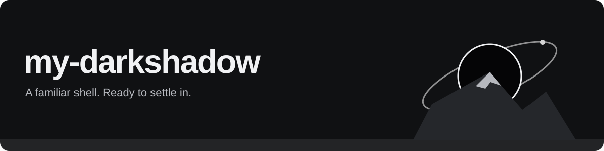

# my-darkshadow

My personal fork of [DarkShadow's Shell](https://github.com/shadowww-dev/DarkShadowShell), with live Codex / Claude Code activity in the Dynamic Island, a matching login screen, display scaling fixes and a reproducible NixOS desktop.

[Install & update](GUIDE.md) · [AI Island](docs/ai-island.md) · [Personal configuration](personal/) · [ISO builds](https://github.com/0Inexis0/my-darkshadow/releases) · [Upstream](https://github.com/shadowww-dev/DarkShadowShell) · [License](LICENSE)

## At a glance

- **See agents at work.** Codex and Claude Code appear beside the clock. Hover for live activity; click for usage details.
- **A coordinated desktop.** A monochrome preset, a bottom dock, German defaults and a matching SDDM login screen.
- **Fix the rough edges.** XWayland and login scaling, recovered menus after Quickshell crashes, clipboard fixes and a visualizer that keeps playing behind windows.
- **Install and update together.** A pinned NixOS configuration, two hardware profiles, live ISO builds and updates from this fork's `main`.

## What this fork adds

These are changes relative to the imported **DarkShadowShell V4.35** baseline, recorded in [personal/UPSTREAM_REVISION](personal/UPSTREAM_REVISION). The original shell already provides the Dynamic Island, music player, widgets, settings and themes; the additions and changed behavior below belong to this fork.

| Area | Fork additions and changes |
| --- | --- |
| **AI Dynamic Island** | Local Codex / Claude Code activity beside the clock, plus a new **AI** tab next to System. The hover card shows an animated agent badge, current activity, project, elapsed time and tool-call count. Usage stays in the separate tab. |
| **Audio visualizer** | Desktop visualization continues behind open windows, including when widget auto-hide is enabled. It stays visible through transparent windows and on exposed desktop areas. Light mode still pauses it. |
| **SDDM login screen** | A matching monochrome greeter with moon branding, a large clock, German date, account and session selection, authentication feedback and power controls. Fonts and wallpaper are bundled. |
| **Display scaling** | `rice-scale-sync` publishes the selected monitor scale as XSettings/Xresources DPI for X11 apps. A separate bridge follows the shell's monitor settings for SDDM without applying the display scale twice or exposing the private home directory. |
| **Crash recovery and menus** | Desktop instance detection uses Quickshell's configuration registry. Wi-Fi, Bluetooth, audio, power, launcher, clipboard, gamebar and control-center helpers can route to a recovered shell. Stop/restart target the desktop configuration. |
| **Quickshell behavior** | Successful configuration reloads stay quiet; errors retain diagnostics. The desktop launcher defaults to non-incremental Qt garbage collection as a workaround for observed crashes and honors an explicit environment override. |
| **Clipboard** | Text, Unicode, newlines and image bytes are restored without waiting for the background clipboard owner. Failed writes do not paste stale data. Opening the panel recovers a missing shell and clears the previous search. |
| **Personal presets** | Coordinated desktop, notification, GTK, terminal, Fastfetch and audio-visualizer settings; a Dynamic bar with four Pac-Man workspaces; a bottom dock with Nautilus, Brave, Discord and Steam; German language/keyboard defaults and Europe/Berlin on NixOS. |
| **NixOS integration** | A personal NixOS module and pinned flake for the desktop, packages, fonts, login screen and user configuration. The `generic` profile follows the host display; `legion` adds the original Intel/NVIDIA laptop configuration. |
| **Installation** | Bootstrap installation on an existing system, an optional NixOS system setup and a guided whole-disk installer on the live ISO. Configuration deployment runs as the desktop user, backs up replaced files and preserves later local edits. |
| **Updates** | The Update Center follows **this fork's `main`**. Managed NixOS updates open a terminal for authentication/build output and stage a boot generation for the next reboot. A separate checkout preserves the installed hardware profile and refuses to overwrite local edits or diverged history. |
| **Desktop integration** | A managed Hyprland authentication agent, GTK portal integration and a `codex://` handler for the ChatGPT desktop entry. Codex/ChatGPT packages are included when available in the pinned package set. The shell owns notifications instead of competing with a second daemon. |
| **ISO releases** | Generic and Legion live images, launcher-based installation, checksummed split release assets with assembly scripts, and a workflow that uploads directly to a draft release. |
| **Verification and publication** | Python regression tests, login/scaling tests, CI and a publication scan for credentials/private state. Installation images, caches, application sessions, clipboard history and local credentials are excluded from the published source. |

See the [guide](GUIDE.md) for installation details, update behavior, backups, rollback and the hardware profile requirements.

## Live agent activity

While a local agent works, the Island shows **Codex**, **Claude**, or both beside the clock, with moving activity bars. Hover opens a card styled like the music player:

- A rotating tonal badge and animated activity wave in the current theme colors.
- Live stages such as thinking, editing files, running commands, searching or writing a response.
- The project, elapsed time, tool-call count and number of active sessions.
- An approval-waiting state when reported, and completion while the card remains hovered.

The hover card contains no token counts or quota limits. Click opens the **AI** tab for session input/output tokens and limits/context information when reported. Cached input is included in token totals; these are session values, not a daily bill or cost estimate.

The reader uses local session files and makes no network or account API requests. Codex Desktop and CLI are detected from their local task events. Claude support covers **local Claude Code** sessions, including Desktop Code when its files/hooks run on this machine. Ordinary Claude chats and remote/cloud sessions do not expose this local lifecycle.

For explicit Claude permission and session-end events, install the optional hooks after installing the shell:

```sh
~/.local/bin/rice-ai install-claude-hooks
```

Existing Claude settings and hooks are preserved, with a backup before changes. Configure the compact display under **Settings → Dynamic island → Codex / Claude**, or open the tab directly with `rice-dashboard island ai`. See [AI Island setup and supported sessions](docs/ai-island.md) for detection, privacy, limitations and hook removal.

## Get started

For an existing **NixOS** installation, download the bootstrap script and preview its plan:

```sh
curl -fsSL https://raw.githubusercontent.com/0Inexis0/my-darkshadow/main/personal/bootstrap.sh -o /tmp/darkshadow.sh
bash /tmp/darkshadow.sh --dry-run --system
```

Run `bash /tmp/darkshadow.sh --system` to stage the desktop, packages and login screen for your next reboot. Add `--profile legion` for the Intel/NVIDIA, 2560 × 1600, 240 Hz, 160% laptop setup.

For a fresh machine, build the live ISO with `nix build .#iso` or use an ISO from [Releases](https://github.com/0Inexis0/my-darkshadow/releases) when one is available. Boot it in UEFI mode and open **Install my-darkshadow** from the launcher. The guided installer erases one selected disk and asks for confirmation before writing.

> **Personal setup:** The installers change desktop configuration and, with `--system`, NixOS packages. The generic profile uses your display's preferred mode. See the [guide](GUIDE.md) for installation, hardware requirements, backups and rollback. ISO installation needs internet for packages missing from the live store.

## Updates and local changes

Use **Settings → Update Center** to update from `0Inexis0/my-darkshadow` on `main`. On a managed NixOS installation, **Update now** stages the desktop and system for the next reboot. Standalone installations retain the original distribution installer with fork update URLs. Upstream changes reach this desktop after they have been integrated into the fork.

The personal deployer saves replaced files under `~/.local/state/my-darkshadow/backups/` and preserves files edited since their last deployment. NixOS system configuration has its own backups; boot an older generation to roll back packages and restore home configuration separately when needed. See [update and rollback](GUIDE.md#update-and-rollback).

## Development

```sh
python3 -B -m unittest discover -s tests -v
python3 -B -m unittest discover -s personal/login/tests -p 'test_*.py' -v
python3 personal/check-publication.py
git diff --check
```

The AI regression suite uses synthetic logs to check simultaneous sessions, lifecycle transitions, streaming usage, tool activity, partial writes, stale sessions and preservation of existing hook settings. The [development guide](GUIDE.md#development-and-releases) also covers Nix checks and ISO builds.

## Credits

Built on [DarkShadow's Shell](https://github.com/shadowww-dev/DarkShadowShell), based on upstream V4.35. Upstream credits and licensing remain in the [original README](docs/UPSTREAM-README.md) and [LICENSE](LICENSE).
