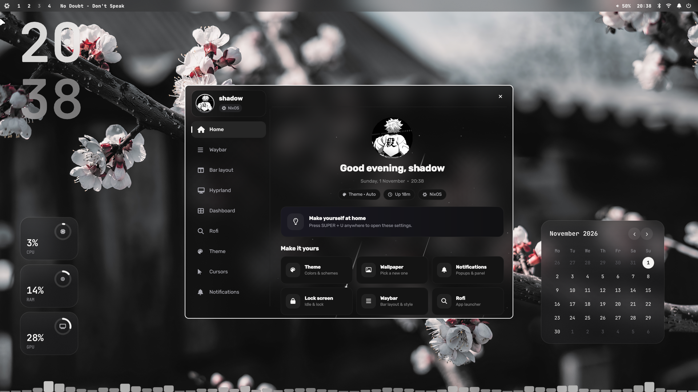

<p align="center">
  
</p>

<p align="center">
  <b>A Hyprland rice with its own Quickshell settings app, bar, launcher, desktop widgets, a dashboard and a dock.</b><br>
  Everything is set with sliders and switches in one app. No config editing.<br>
  Made by <a href="https://www.tiktok.com/@shadoww.dev">shadoww.dev</a>
</p>

<p align="center">
  
  
  
  
</p>
<p align="center">
  
  
  
  
</p>

<p align="center">
  <a href="#install-in-one-minute">Install</a> ·
  <a href="#supported-systems">Systems</a> ·
  <a href="#features">Features</a> ·
  <a href="#keybinds">Keybinds</a> ·
  <a href="docs/INSTALL.md">Docs</a> ·
  <a href="docs/CUSTOMIZE.md">Customize</a>
</p>

---

## Screenshots
<p align="center">
  
</p>
<p align="center">
  <br>
  <sub>The Settings app (<code>SUPER + U</code>) with desktop widgets, calendar and audio visualizer</sub>
</p>
<!-- more screenshots: put the files in assets/ and add them here -->

## Supported systems
The bar, the dashboard, the welcome window and Settings show **your distro's logo** automatically.

| System | Status | How |
| --- | --- | --- |
| **NixOS** | main system | the module in `nix/`, then `./install.sh` |
| **Arch Linux** | supported | `./install.sh` |
| **CachyOS** | new in V2.70 | `./install.sh` (Arch based: its repositories and `paru` are used) |
| **EndeavourOS, Garuda** | Arch route | `./install.sh` |
| **Fedora, Nobara** | new in V2.60 | `./install.sh` (COPR for Hyprland and Quickshell) |
| **Bazzite, Silverblue** | commands only | the installer prints the `rpm-ostree` steps |
| **Manjaro** | may not work | its packages are held back, Hyprland can be older than 0.55 |

CachyOS and Fedora support is new: if something does not install, open an issue with the installer log and it gets fixed fast.

## Install in one minute
**Arch Linux / CachyOS / EndeavourOS**
```bash
sudo pacman -S --needed git base-devel
git clone https://github.com/shadowww-dev/shadows-shell && cd shadows-shell
./install.sh
```

**Fedora / Nobara**
```bash
sudo dnf install -y git
git clone https://github.com/shadowww-dev/shadows-shell && cd shadows-shell
./install.sh
```

**NixOS**: see [Installation](#installation) below. Then log out and pick Hyprland, and press `SUPER + U`.

## Features
**Settings app** (`SUPER+U`) in the spirit of Material 3: a navigation rail (Home, Wallpaper, Appearance, Motion, Desktop, Bar & island, Sound, System, Gaming, About) with tabs, Google icons, colors made from your theme and a search over every setting.

**Font**: the whole interface uses **Google Sans Flex** (and Google Sans Code for codes), both open source under the SIL Open Font License; the terminal keeps JetBrainsMono Nerd Font.

| Area | What you get |
| --- | --- |
| **DarkShadow bar** | the Quickshell bar: style Dynamic (the default: an island in the middle that is your clock and grows into the player, volume, workspaces, notifications, today and recording), Flat, Island, Islands, Pills or Notch, auto-hide, a soft shadow, position top or bottom, size, transparency, workspaces as dots, Pac-Man or letters, clock with seconds, a switch back to Waybar |
| **Bar styles** | Flat, Floating, Islands, **One island**; group styles None, Pills, Segmented |
| **Autohide** | bar slides in when the pointer touches the screen edge |
| **Distro logo** | the logo of your distro (NixOS, Arch, CachyOS, Fedora, Nobara, EndeavourOS ...) in the bar, the dashboard, the welcome window and Settings, picked automatically |
| **Desktop widgets** | frosted glass over your blurred wallpaper (or plain cards), auto-hide while windows are open; clock, calendar, weather, music, resources (CPU, RAM, GPU), user card, battery gauges in soft shapes (CPU, RAM, GPU, heat, battery), the date in a flower, and a see-through audio visualizer (Bars like cava in a terminal, Mirror, Wave, Dots, in your Theme color, a gradient or rainbow), a to-do list, a focus timer and a note; three widget styles (DarkShadow, Google, Outline); colors that turn light or dark with your wallpaper; Sky, Now playing, Player, Play button, Lyrics, Storage and CPU · GPU · RAM; Edit mode with a side panel for widgets, quick settings, the bar and the visualizer |
| **Today & System** | the dashboard lives in the bar: click the clock (or SUPER + ALT + D) and a Material 3 card grows out of the bar with today (calendar, weather, the day as a wave) and System (CPU, GPU and RAM in wavy rings, the disk); right-click for System. Settings > Dynamic island: weather and date beside the time, what it grows into (music, volume, workspaces, notifications, the charger), which tab a click opens and how fast the card closes |
| **Wallpaper picker** | SUPER + W: your wallpapers in a sheet with search, shuffle and keys; colors follow |
| **Bar layout** | five ready-made Material 3 layouts, and drag and drop the modules between left, center and right: launcher, workspaces, window title, music, the island (your clock), tray (right-click an app: its menu and Close app), volume, Bluetooth, Wi-Fi, battery, notifications, power |
| **Dock** | bottom, left or right edge, its own app menu with search, pinned favourite apps (also in Settings > Dock), open apps, hover to reveal, media player, tinted icons |
| **Hyprland** | gaps, borders, rounding, blur, shadows and animations from sliders, no config editing |
| **Theme** | 21 color schemes: Auto and Grey from your wallpaper, six monochrome (Mono, Slate, Stone, Steel, Ash, Ink) and thirteen colors (Navy, Ocean, Sky, Teal, Mint, Forest, Lime, Gold, Sunset, Ember, Rose, Orchid, Violet). They recolor Waybar, borders, notifications and the lock screen |
| **Control center** | `SUPER + N` or the bell: switches, sliders, music with a wavy, seekable progress line and your notifications, with smooth Material 3 motion |
| **Notifications** | shown by the shell in the Google style (or swaync, one click away): pop-ups with the app icon in your shape, pictures, action buttons and a line that shows how long they stay; position, width, time on screen, six themes, text size, corners, transparency and blur, live preview and a test button |
| **Sfx & sounds** | interface sounds in the shell's own parts (clicks, switches, sliders, typing), eight packs (Pebble, Tap, Soft, Pluck, Keys, Crystal, Bubble, Retro), volume, each sound on or off, quiet music for the welcome; ten notification sounds (Glass, Droplet, Chime, Bubble, Marimba, Aurora, Ping, Harp, Keys, Ripple) or Off |
| **Search** | "Search anything!" in Settings finds every setting ("bar position", "blur", "clock font") and jumps to it |
| **Updates** | a notification when a new version is out ("Update is Available!"), version and Update now button in the About tab of the dashboard, `rice-update` in a terminal |
| **Idle & Lockscreen** | lock, screen-off and sleep timers; lock screen with Big / Stacked / Minimal clock in seven fonts (white hours, grey minutes), center or left layout, greeting, avatar, Pill / Box / Line password field, power buttons, screenshot / wallpaper / color background and media, resources, weather and notification lines |
| **Launcher** | the built-in DarkShadow Launcher: 5 themes (Shadow, Graphite, Midnight, Rose, Paper), layouts list / grid / full-width bar / split (wallpaper on the left), position top, center or bottom, width, rows, corner radius, transparency, blur, font size, icons |
| **Cursors** | Bibata, Hyprcursor themes (Rose Pine) and packs you can download in Settings: Catppuccin, Phinger; live preview |
| **Appearance** | Colors (every color role of your theme), Fonts (typography: text size, heavier headings, rounded letters, the Material 3 type scale), Components (switch icons, corner shape, slider thickness, wavy progress) |
| **Motion** | Hyprland animation styles (calm, lively, bouncy, snappy, minimal) and speed, spring and easing graphs, durations, a shape you can throw |
| **Keyboard** | up to four layouts, the one in use, the keys that switch them, search over every layout |
| **Game bar** | `SUPER + G`: CPU and GPU with their heat, RAM, ping, screenshot, record, microphone, power mode, gaming mode, Do Not Disturb, volume and brightness over your game |
| **Welcome intro** | once after installing: night falls over the desktop, a few words, the moon logo draws itself in, "Take a look" opens it up again and Settings starts a short tour (it lights up one part at a time). Play it again with `rice-welcome show`, only the tour: `rice-welcome tour` |
| **Performance & gaming** | one switch turns off all blur and transparency (Hyprland, kitty, bar, launcher, notifications, dashboard, dock, widgets); Gaming mode with options to keep blur, animations, shadows or gaps, Do Not Disturb (Settings > Services) |
| **Your settings everywhere** | `./sync.sh` saves your Settings choices to `settings/`, `./install.sh` puts them on your other computers (files you changed there are kept) |
| **Installer** | interactive (Install, Update, Choose, Restore), backs up everything, supports Arch, CachyOS, Fedora and NixOS, warns when Hyprland is too old |

## Keybinds
`SUPER` is the main modifier.

| Keys | Action |
| --- | --- |
| `SUPER + U` | open **Settings** |
| `SUPER + Q` | terminal |
| `SUPER + E` | file manager |
| `SUPER + R` | app menu |
| `ALT + Space` | app launcher (DarkShadow Launcher) |
| `SUPER + C` | close window |
| `SUPER + V` | toggle floating |
| `SUPER + P` | pseudo-tile |
| `SUPER + J` | toggle split direction |
| `SUPER + M` | exit Hyprland |
| `SUPER + ←/→/↑/↓` | move focus |
| `SUPER + 1 … 0` | go to workspace |
| `SUPER + SHIFT + 1 … 0` | move window to workspace |
| `SUPER + S` | show/hide scratchpad |
| `SUPER + SHIFT + S` | move window to scratchpad |
| `SUPER + scroll` | next/previous workspace |
| `SUPER + left mouse` | drag window |
| `SUPER + right mouse` | resize window |
| `ALT + ]` / `ALT + [` | volume up / down |
| `SUPER + F12` / `F11` / `F10` | volume up / down / mute (with on-screen display) |
| media keys | play/pause, next, previous |
| `Fn` volume / brightness keys, headset `+` `-` | volume, mute, microphone, brightness |
| `Print` / `SHIFT + Print` | screenshot of a region / the whole screen |
| `SUPER + SHIFT + R` | record a region (press again to stop) |
| `SUPER + A` | control center (quick switches) |
| `SUPER + G` | game bar |
| `SUPER + N` | control center (notifications) |
| `SUPER + ALT + W` | edit desktop widgets (add, move, resize, style) |
| `SUPER + ALT + D` | today & system card from the bar's island |
| `SUPER + W` | wallpaper picker |

## Installation

### Arch Linux (and CachyOS, EndeavourOS, Garuda)
```bash
sudo pacman -S --needed git base-devel
git clone https://github.com/shadowww-dev/shadows-shell
cd shadows-shell
./install.sh
```
The installer updates your system, installs every package (Hyprland, Quickshell, Waybar, swaync, kitty, fish, Nautilus, fonts, Papirus icons, Bibata cursor, btop, cava, fastfetch, cmatrix, peaclock and more), uses the AUR helper you have (`paru` comes with CachyOS, or it offers `yay`) for the few AUR packages, copies the configs and sets everything up. At the end it warns you when your Hyprland is older than 0.55. Then log out and pick Hyprland.

### Fedora (and Nobara)
```bash
sudo dnf install -y git
git clone https://github.com/shadowww-dev/shadows-shell
cd shadows-shell
./install.sh
```
The installer turns on two COPR repositories (`nett00n/hyprland` for the newest Hyprland, its tools and Quickshell, `scottames/awww` for the wallpaper daemon), installs the rest from Fedora, and downloads what Fedora does not package (Nerd Font icons, Bibata cursor). Packages your Fedora does not have are listed and skipped. Fedora Atomic (Bazzite, Silverblue) gets the `rpm-ostree` commands to run instead.

### NixOS
```bash
git clone https://github.com/shadowww-dev/shadows-shell
cd shadows-shell
```
Add `imports = [ ./path/to/shadows-shell/nix/module.nix ];` to `/etc/nixos/configuration.nix`, run `sudo nixos-rebuild switch`, then `./install.sh`.

### Options
| Flag | What it does |
| --- | --- |
| `--yes` | install everything without questions |
| `--dry-run` | show what would happen, change nothing |
| `--no-packages` | skip the package step |
| `--update` | get the newest version and update apps and scripts (keeps your configs) |
| `--restore` | put back the files from the last backup |

Every file the installer replaces is saved in `~/.config/darkshadows-shell-backup-<time>/`.

### Updating
Run `rice-update` (or `./install.sh --update` in the repo), or press **Update now** in the About tab of the dashboard or in the update notification.

## Layout
| Path | Contents |
| --- | --- |
| `bin/` | helper scripts installed to `~/.local/bin` |
| `quickshell/` | Settings app (`rice-settings`) and widgets/dock (`rice-desktop`) |
| `config/` | dotfiles installed to `~/.config` (Hyprland, Waybar, ...) |
| `install/` | installer UI and distro detection |
| `lua/` | Hyprland add-ons: keybinds, widgets autostart |
| `wallpapers/` | original wallpapers, copied to `~/Pictures/Wallpapers` |
| `sounds/` | notification sounds (made by `install/tools/make-sounds.py`, CC0) |
| `VERSION` | the current version, used by the update check |
| `nix/`, `flake.nix` | NixOS module |
| `.github/` | CI (shellcheck, dry-run install) and issue template |

## Maintainers
`./sync.sh` copies your current setup from this machine into the repo (paths become `@HOME@`, no username is stored) and scans for secrets. Your choices in Settings go to `settings/`; `./install.sh` applies them on other computers, keeps files you changed there, and `./install.sh --update --use-saved-settings` takes the saved ones anyway.

To release a new version, put the new number in `VERSION` (for example `2.03`) and push. Everyone gets the update notification within a few hours.

## Thanks
The idea of the Dynamic bar's island, a clock that grows into the player, notifications and more, comes from [hyprdots](https://github.com/fedyaqq34356/hyprdots) by fedyaqq34356. The island here is written from scratch.

## License
MIT, see `LICENSE`.
