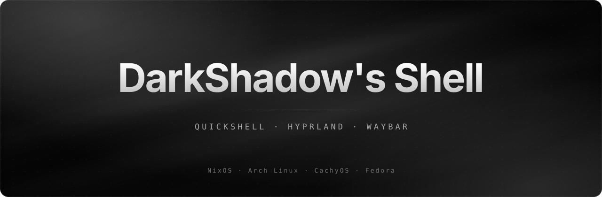
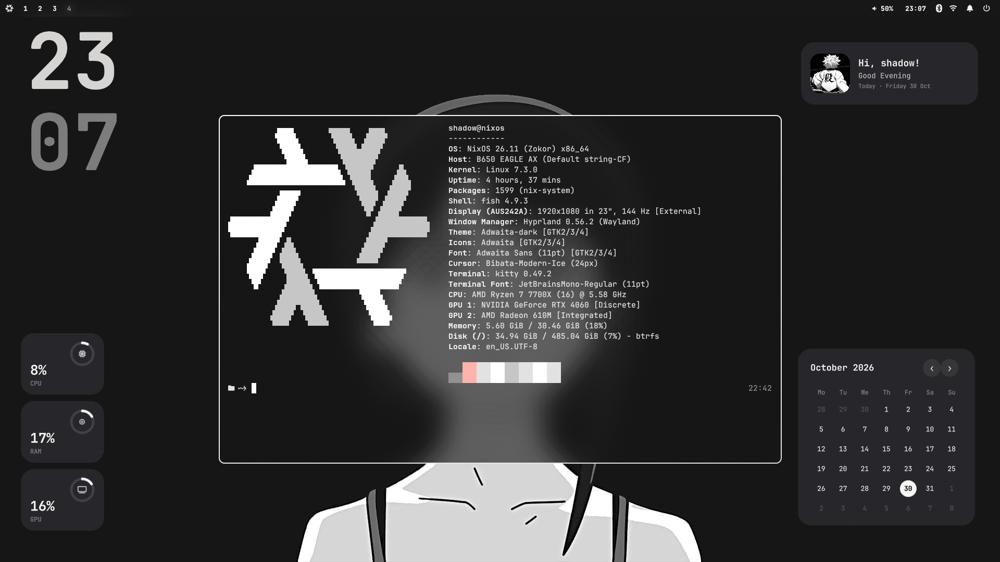
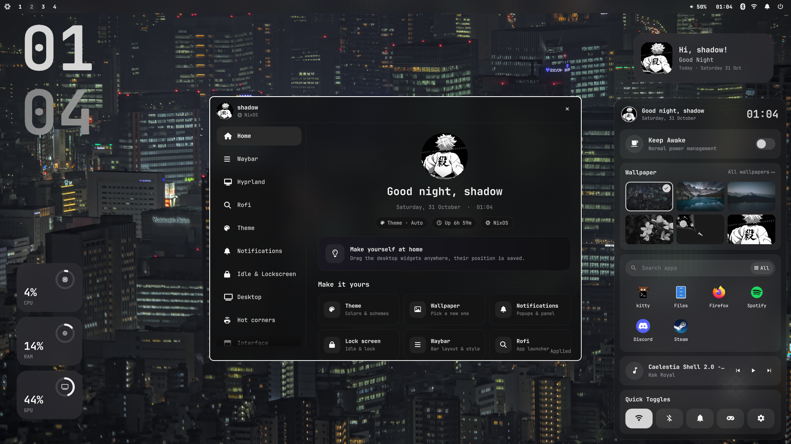

<p align="center">
  
</p>

<p align="center">
  <b>A Hyprland rice with its own Quickshell settings app, Waybar, desktop widgets and a dock.</b><br>
  Made by <a href="https://www.tiktok.com/@shadoww.dev">shadoww.dev</a>
</p>

<p align="center">
  
  
  
  
</p>

<p align="center">
  <a href="#installation">Install</a> ·
  <a href="#features">Features</a> ·
  <a href="docs/INSTALL.md">Docs</a> ·
  <a href="docs/CUSTOMIZE.md">Customize</a>
</p>

---

## Screenshot
<p align="center">
  
</p>
<p align="center">
  <br>
  <sub>The Settings app (<code>SUPER + U</code>) and the hot corner panel</sub>
</p>

## Features
**Settings app** (`SUPER+U`), fourteen pages: Home, Waybar, Bar layout, Hyprland, Dashboard, Rofi, Theme, Cursors, Notifications, Idle & Lockscreen, Desktop, Hot corners, Interface, Services.

| Area | What you get |
| --- | --- |
| **Waybar** | layout editor (move modules between left, center and right), saved presets, position top or bottom, bar height, opacity |
| **Bar styles** | Flat, Floating, Islands, **One island**; group styles None, Pills, Segmented |
| **Autohide** | bar slides in when the pointer touches the screen edge |
| **Distro logo** | NixOS logo on NixOS, Arch logo on Arch, and so on |
| **Hot corner** | touch a screen corner for a panel with Keep Awake, screen recording, screenshots, quick toggles (Wi-Fi, Bluetooth, Do Not Disturb, Gaming mode, microphone, Settings) and now playing; sections, toggles, corner, look and animation are set in Settings > Hot corners |
| **Desktop widgets** | frosted glass over your blurred wallpaper (or plain cards), auto-hide while windows are open; clock, calendar, weather, music, resources (CPU, RAM, GPU), user card, battery and a see-through audio visualizer (Bars, Mirror, Wave, Dots); a widget editor on the desktop to add, move, resize and style them |
| **Dashboard** | slides up from the bottom of the screen (SUPER + ALT + D or push the pointer against the bottom edge): Dashboard (weather, calendar, usage, music), Wallpaper (big wallpaper cards, search, random), Performance (CPU, GPU, storage, network, memory, battery), About (your computer, distro, updates); cards you can remove, add, resize and move, looks Shadow, Graphite, Aurora and Frost |
| **Bar layout** | drag and drop Waybar modules between left, center and right, reorder the system icons, Battery module |
| **Dock** | pinned apps, hover to reveal, media player, tinted icons |
| **Hyprland** | gaps, borders, rounding, blur, shadows and animations from sliders, no config editing |
| **Theme** | 21 color schemes: Auto and Grey from your wallpaper, six monochrome (Mono, Slate, Stone, Steel, Ash, Ink) and thirteen colors (Navy, Ocean, Sky, Teal, Mint, Forest, Lime, Gold, Sunset, Ember, Rose, Orchid, Violet). They recolor Waybar, borders, notifications and the lock screen |
| **Notification center** | Deck: switches (Wi-Fi, Bluetooth, Do Not Disturb, night light, keep awake), power modes, notifications, media, volume and brightness, power buttons; floating or against the edge, left or right, any size, blur and transparency |
| **Notifications** | swaync popups and panel: position, layout, widgets (title, Do Not Disturb, media, volume, quick buttons), size, timeout, icon size, Glass / Solid / Outline look, opacity, radius, blur, live preview and a test button |
| **Notification sounds** | six original sounds (Glass, Droplet, Chime, Bubble, Marimba, Aurora) or Off, with volume; silent during Do Not Disturb |
| **Updates** | a notification when a new version is out ("Update is Available!"), version and Update now button in the About tab of the dashboard, `rice-update` in a terminal |
| **Idle & Lockscreen** | lock, screen-off and sleep timers; lock screen with Big / Stacked / Minimal clock in seven fonts (white hours, grey minutes), center or left layout, greeting, avatar, Pill / Box / Line password field, power buttons, screenshot / wallpaper / color background and media, resources, weather and notification lines |
| **Rofi** | 5 themes (Shadow, Graphite, Midnight, Rose, Paper), layouts list / grid / full-width bar, position top, center or bottom, width, rows, corner radius, transparency, blur, font size, icons |
| **Cursors** | Bibata, Hyprcursor themes (Rose Pine) and packs you can download in Settings: Catppuccin, Phinger; live preview |
| **Fonts** | one place to set the main and icon fonts |
| **Notifications** | swaync with a button that opens Settings |
| **Welcome window** | "Welcome to DarkShadow's Shell" greeting once per login; turn off with `rice-welcome off` or the link in the window |
| **Performance & gaming** | one switch turns off all blur and transparency (Hyprland, kitty, Waybar, rofi, notifications, dashboard, hot corner, dock, widgets); Gaming mode with options to keep blur, animations, shadows or gaps, Do Not Disturb (Settings > Services) |
| **Your settings everywhere** | `./sync.sh` saves your Settings choices to `settings/`, `./install.sh` puts them on your other computers (files you changed there are kept) |
| **Installer** | interactive (Install, Update, Choose, Restore), backs up everything, supports Arch and NixOS |

## Keybinds
`SUPER` is the main modifier.

| Keys | Action |
| --- | --- |
| `SUPER + U` | open **Settings** |
| `SUPER + Q` | terminal |
| `SUPER + E` | file manager |
| `SUPER + R` | app menu |
| `ALT + Space` | app launcher (rofi) |
| `SUPER + C` | close window |
| `SUPER + V` | toggle floating |
| `SUPER + P` | pseudo-tile |
| `SUPER + J` | toggle split direction |
| `SUPER + M` | exit Hyprland |
| `SUPER + ←/→/↑/↓` | move focus |
| `SUPER + 1 … 0` | go to workspace |
| `SUPER + SHIFT + 1 … 0` | move window to workspace |
| `SUPER + S` | show/hide scratchpad |
| `SUPER + SHIFT + S` | move window to scratchpad |
| `SUPER + scroll` | next/previous workspace |
| `SUPER + left mouse` | drag window |
| `SUPER + right mouse` | resize window |
| `ALT + ]` / `ALT + [` | volume up / down |
| `SUPER + F12` / `F11` / `F10` | volume up / down / mute (with on-screen display) |
| media keys | play/pause, next, previous |
| `Fn` volume / brightness keys, headset `+` `-` | volume, mute, microphone, brightness |
| `Print` / `SHIFT + Print` | screenshot of a region / the whole screen |
| `SUPER + SHIFT + R` | record a region (press again to stop) |
| `SUPER + A` | open the hot corner panel |
| `SUPER + ALT + W` | edit desktop widgets (add, move, resize, style) |
| `SUPER + ALT + D` | dashboard (slides up from the bottom; pushing the pointer against the bottom edge opens it too) |
| `SUPER + W` | wallpapers (Wallpaper tab of the dashboard) |

## Installation

### Arch Linux (and CachyOS, EndeavourOS, Manjaro)
```bash
sudo pacman -S --needed git base-devel
git clone https://github.com/shadowww-dev/shadows-shell
cd shadows-shell
./install.sh
```
The installer updates your system, installs every package (Hyprland, Quickshell, Waybar, swaync, rofi, kitty, fish, Nautilus, fonts, Papirus icons, Bibata cursor, btop, cava, fastfetch, cmatrix, peaclock and more), offers to install `yay` for the few AUR packages, copies the configs and sets everything up. Then log out and pick Hyprland.

### NixOS
```bash
git clone https://github.com/shadowww-dev/shadows-shell
cd shadows-shell
```
Add `imports = [ ./path/to/shadows-shell/nix/module.nix ];` to `/etc/nixos/configuration.nix`, run `sudo nixos-rebuild switch`, then `./install.sh`.

### Options
| Flag | What it does |
| --- | --- |
| `--yes` | install everything without questions |
| `--dry-run` | show what would happen, change nothing |
| `--no-packages` | skip the package step |
| `--update` | get the newest version and update apps and scripts (keeps your configs) |
| `--restore` | put back the files from the last backup |

Every file the installer replaces is saved in `~/.config/darkshadows-shell-backup-<time>/`.

### Updating
Run `rice-update` (or `./install.sh --update` in the repo), or press **Update now** in the About tab of the dashboard or in the update notification.

## Layout
| Path | Contents |
| --- | --- |
| `bin/` | helper scripts installed to `~/.local/bin` |
| `quickshell/` | Settings app (`rice-settings`) and widgets/dock (`rice-desktop`) |
| `config/` | dotfiles installed to `~/.config` (Hyprland, Waybar, ...) |
| `install/` | installer UI and distro detection |
| `lua/` | Hyprland add-ons: keybinds, widgets autostart, hot corner |
| `wallpapers/` | original wallpapers, copied to `~/Pictures/Wallpapers` |
| `sounds/` | notification sounds (made by `install/tools/make-sounds.py`, CC0) |
| `VERSION` | the current version, used by the update check |
| `nix/`, `flake.nix` | NixOS module |
| `.github/` | CI (shellcheck, dry-run install) and issue template |

## Maintainers
`./sync.sh` copies your current setup from this machine into the repo (paths become `@HOME@`, no username is stored) and scans for secrets. Your choices in Settings go to `settings/`; `./install.sh` applies them on other computers, keeps files you changed there, and `./install.sh --update --use-saved-settings` takes the saved ones anyway.

To release a new version, put the new number in `VERSION` (for example `2.03`) and push. Everyone gets the update notification within a few hours.

## License
Not chosen yet. Add a `LICENSE` file before sharing widely.
